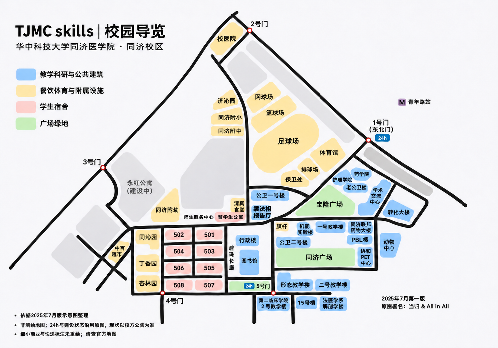

# 地图、快递与周边美食

资料查询日期：2026-11-13。以下区分可用官方入口、历史线索和未核实的本地经验。实际查询时重新核对。

## 地图

[打开清晰图](../assets/campus-map-clear.png) · [素材来源说明](visual-assets.md)。依据 **2025 年 7 月版**示意图重绘，保留原图署名“当归 & All in All”。图中“24h”和“建设中”是历史标注，不代表当前状态。网球场左侧标的是**济沁园**。校内没有游泳馆属于维护者提供的信息，未独立核验当前场馆名录；本指南不以商业广告作校内游泳推荐。

默认武汉华中科技大学同济医学院同济校区。学院官网搜索索引列地址为武汉市硚口区航空路 13 号；官网直开超时，因此该地址仅作实体消歧，不能自动作为个人收件地址。具体寄件地址按学校、宿舍和承运商要求确认。

- [官方校园地图移动端](https://map.hust.edu.cn/OneMapMobile/Home/OneMap)：已读到地图界面及地点检索、餐饮、交通、生活服务等入口；本次未操作同济校区图层，未核验建筑坐标。
- [网信办“一张图服务”说明](https://imo.hust.edu.cn/info/1400/5675.htm)：2024-01-24，正文已读。说明移动端可免登录，PC 和移动端可校外访问。该说明不能保证服务当前可用或点位刚刚更新。

使用时选择同济校区或搜索完整校名，按需求找校门、教学楼、图书馆、食堂、宿舍、快递点。路线以用户实际出发点及可通行校门为起点，缺失时可先给地图入口，不编造固定耗时。小红书地图只补充经验；地图图片没实际读取，就不描述其标注和方位。

## 快递

**尚未建立当前已核验站点清单。** 优先查后勤或学生事务公告、站点公示及用户本人的承运商取件通知。用户转述取件地点即可，无需索取取件码、电话号码或完整运单。

收到新证据后按“承运商—站点名—校区—位置地标—取件/寄件业务—营业时间—适用日期—来源”整理。不同承运商不一定共用站点，柜机、自提点和代收点分开。

历史检索线索仅供继续找新资料：

| 来源 | 原始日期与读取深度 | 有限可用信息 |
|---|---|---|
| [同济指南丨快递篇](https://www.sohu.com/a/418126955_120068238) | 2020-09-13；转载正文已读，文末署校学生会（医科） | 曾提到韵达在同沁园食堂北面、申通在学子苑 502 与 504 栋之间、京东自提点在同沁园与丁香园之间小路；均不能当作当前地点 |
| [四月权益月报](https://www.sohu.com/a/674422700_121124317) | 2023-05-10；非校方账号转载正文已读 | 曾把同济校区快递收发写为“学子苑中商超市旁”；与其他旧文名称有差异，不擅自合并或订正 |

以上是转载线索，不属于官网目录。未获新证据时，回答应明确“当前站点待核实”，而不是直接给旧址让用户前往。

## 美食与商圈

按实际需求选择范围，下面不是按距离排序的清单，也不是已核验的店铺推荐：

| 区域 | 用途 | 证据与下一步 |
|---|---|---|
| 校内、校门与航空路 | 日常吃饭、过早、课间就餐 | 本指南关注范围；具体食堂窗口、门店及营业需新证据 |
| 武广商圈 | 逛街与聚餐 | 官方商业介绍提供武商MALL、国广、世贸等检索起点；核对具体商场和分店 |
| 协和医院周边 | 医院附近就餐 | 以武汉协和本部附近作检索锚点，不能混入北京协和或其他院区 |
| 万松园 | 小吃、聚餐的扩展检索 | 武汉市商务局 2026 年点位资料提及美食街区；具体门店待查 |
| 江汉路—汉口江滩 | 外出逛吃的扩展检索 | 同份官方资料提及该片区；不能称为校园步行即达 |

来源：

- [武汉市商务局：武汉百货和购物中心介绍](https://sw.wuhan.gov.cn/xwdt/gzdt/202207/t20220721_2010150.shtml)，2022-07-21，正文已读：武广商圈部分提及武商MALL·国广、世贸、恒隆、K11、凯德武胜等。它是历史商业介绍，不能作为现时店铺名录或距离证明。
- [武汉市商务局：2026 武汉双节消费点位总图](https://sw.wuhan.gov.cn/xwdt/gzdt/202609/t20260928_2854150.shtml)，2026-09-28，正文已读：出现武商MALL、恒隆及万松园、江汉路—汉口江滩等点位；节庆活动不能当永久安排。
- [武汉协和教学平台公开页面](https://jxpt.whuh.com/pc/recruit/FurtherPosition/more)，界面与页脚已读：地址为解放大道 1277 号，只用于医院地理消歧，不据此推断餐馆。

具体推荐前核对分店、在营状态、菜系、当前人均、营业时间及来源日期；有需要再问预算、口味和出发点。只搜到旧帖时给候选片区或门店线索，不断言“必吃”“最便宜”或具体价格。预算建议和实际菜单价格分别标注。

## 健身与住宿

维护者提供的生活线索包括校内健身房、汉口 K11 的乐刻以及秋果酒店。可用定位、门店核验与美团搜索方法统一放在[健身与住宿定位](fitness-and-hotels.md)，不把未核实的商业广告写成校内设施。
