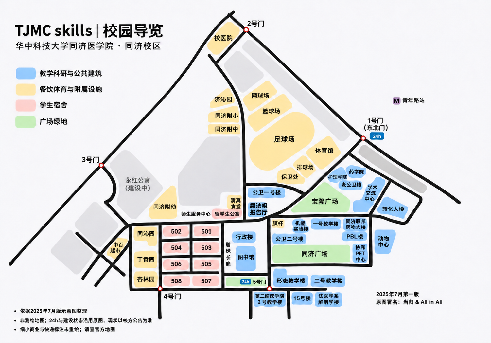

# TJMC skills：学生使用手册

这是一份可以直接执行的基础指南。固定入口来自 [官网导航](official-websites.md)；具体营业、站点和招生时限仍需查询当日信息。资料整理日期：2026-11-13。

## 1. 到校先解决找路

上图依据 **2025 年 7 月**示意图整理，保留原图署名“当归 & All in All”；“24h”和建设状态须以学校当前通知确认。来源及使用边界见[素材说明](visual-assets.md)。

打开 [官方校园地图](https://map.hust.edu.cn/OneMapMobile/Home/OneMap)，选择或搜索同济医学院／同济校区。学校实体识别地址为武汉市硚口区航空路 13 号，不要把华科主校区或上海同济设成目的地。

先定位自己需要的校门、宿舍、教学楼、食堂、图书馆，再保存官方地图链接。去医院上课、见习或办事时重新确认医院与院区，学院校园、同济医院、协和医院不是可以互换的目的地。

用户说“从宿舍到教学楼怎么走”时，只需补充出发建筑与目标建筑名称；不需要提供宿舍房号。实际路线要在地图或现场路标确认后再描述。短视频适合认识环境，校门开放和绕行按当日通知。

## 2. 取快递与寄行李

已到件：查看本次物流详情里的承运商和站点名称 → 在地图或后勤公告核对站点 → 确认今天的服务时间 → 去取件。不能用“京东通常在哪”替代这一件包裹的通知。

未寄件：先向学校报到说明、宿舍管理或承运商确认完整收件格式和大件接收安排，再下单；学院公开地址不是每位学生的完整收件地址。

目前资料库没有当年已核实的站点名录。旧文中的同沁园、丁香园、学子苑等只能帮助继续找新信息，不能作为现行站点答复。可通过 [总务后勤处](https://hq.hust.edu.cn/) 和 [医学院机构导航](https://www.tjmu.edu.cn/xygk/zzjg.htm) 查相关服务部门。

## 3. 吃饭按场景选范围

| 场景 | 先查的范围 | 下一步 |
|---|---|---|
| 课间、日常工作日 | 校内食堂、校门与航空路 | 先核对当天窗口和价格，不先跑远处探店 |
| 同学聚餐、购物后吃饭 | 武广、武商MALL、国广／世贸相关片区 | 确认是哪家商场、哪处分店，再看近期菜单和交通 |
| 协和附近办事后吃饭 | 武汉协和本部、解放大道周边 | 用准确院区做检索锚点，排除外地协和 |
| 专门外出逛吃 | 万松园、江汉路等扩展区域 | 另算往返交通时间，不能默认步行可达 |

这些是范围选择，不是具体餐馆推荐。要推荐店铺时记录“店名及分店—地址—菜系—菜单或近期人均来源—营业状态—交通—日期”。“人均 40 元”可作为筛选预算，不能直接写成某店实测价格。抖音团购价、普通单点价、多人套餐总价分别记录。

武广等片区的来源和适用边界见 [校园生活](campus-life.md)。同济医学院官网有 [2026 届毕业餐活动报道](https://www.tjmu.edu.cn/info/1106/11908.htm)（2026-06-15，搜索索引可读、正文直开超时）；它只能说明一次校园餐饮活动，不证明活动菜品每天都有。

## 4. 课程材料这样归档

从 [各年级培养计划](https://ugs.hust.edu.cn/fwzq/pyjh.htm) 找本人**入学年级**的版本，再匹配专业和学制。2026 版适用 2026 级，不能直接套给其他年级。每门课可建如下索引，不要求用户一次补齐：

| 字段 | 要保存什么 |
|---|---|
| 身份 | 课程全名、专业、学制、入学年级、当前学期 |
| 权威材料 | 本学期大纲、教师要求、教材版本、正式课表 |
| 学习材料 | 讲义、课堂笔记、课后练习，注明出处 |
| 往年题 | 年份、官方旧卷／回忆版／练习题、答案来源 |
| 复盘 | 题目对应章节、错误原因、教材依据、再次练习情况 |

可以帮助把材料按章节排列、制定复习节奏、解释用户提供的题目；没有读到大纲时不虚构本校必考点、试卷结构或成绩占比。涉及成绩单、学籍、课程与考试办事时，查 [医学教务处职责与办事定位](https://ugs.hust.edu.cn/zzjg/jgsz.htm)。

## 5. 柳叶刀削铅笔与金豆豆

**柳叶刀削铅笔**：在微信按完整名称查找公众号，先核对账号介绍，再搜课程名称和年份。拿到文章链接后，可让技能整理“文章对应课程—题目年份—适用专业—获取方式”。目前尚未核实账号标识与文章目录。

**金豆豆**：这是维护者提供的打印店小书名称，尚未核验实物或售卖点。先问实际售卖打印店有没有对应课程的小书，再看目录、收录年份、版本、答案来源和价格。没有已核实的店址与售价，因此不能直接替你推荐某一家店或报固定价格。

把这两个入口与正式教学材料配合使用：往年题帮助了解题型与练习，不代表每年题目相同。详见 [学习与保研](study-and-admissions.md)。

## 6. 保研网站分工

| 你要办的事 | 先打开哪里 | 需要对应的年份或对象 |
|---|---|---|
| 确认自己能否获得本校推荐资格 | [本科生院](https://ugs.hust.edu.cn/) ＋ [所属院系官网](https://www.hust.edu.cn/yxsz.htm) | 本科毕业届、学院当年推荐办法 |
| 确认目标单位是否接收 | [华科研招网](https://gszs.hust.edu.cn/) 或目标学校研招网 | 研究生入学年、具体专业与学位类型 |
| 查临床学院考核和材料 | 研招网当年院系细则；[协和医学教育](https://www.whuh.com/yxjy2.htm)、[同济医院医学教育](https://www.tjh.com.cn/api/preview/1/146) | 院系/医院、专业、当年通知 |
| 正式填报和确认通知 | [全国推免服务系统](https://yz.chsi.com.cn/tm/) | 当年系统安排和本人待办事项 |

材料先按目标通知列清单，再准备；不要根据短视频经验默认每个院系都要求相同证明。可整理成绩/排名、外语、科研与个人陈述等用户已有材料，但具体是否提交由目标通知决定。

可用时间线模板：“本校资格申请 → 目标单位报名/考核 → 全国系统正式流程 → 后续材料和入学要求”。阶段可能交叉，日期只能填适用通知中的日期。2027 年入学办法可能在 2026 年发布，见 [华科 2027 年接收办法](https://gszs.hust.edu.cn/info/1106/4150.htm)。

## 7. 看抖音时优先看什么

最有用的是能给出准确校区、具体地点、拍摄时间和实际办事过程的作品。校史和校园镜头适合认识学校；商家推广和泛升学分析单独看，不能当作学校承诺。

当前找到的作品直链在 [抖音来源索引](douyin-source-index.md)。它明确标出哪些只读到搜索文案，哪些内容仍未看过；地图、快递、往年题、医科保研等缺口不会用无关视频补齐。

## 8. 奖学金与研究生荣誉

重点关注**国家奖学金、研究生三好学生／三好学生标兵、学术新星奖学金、裘法祖奖学金**。本科与研究生分开查看，项目年度、资格、名额和提交时间以本院当年通知为准。“学术标兵”的正式项目名称还需对应当年通知，不能自动与学术新星混称。

[奖助与求职](scholarships-and-career.md)已整理各项官网。先看学校规则，再看院系申报安排；已结束的年度窗口不当作正在报名。

## 9. 求职关注公卫学院渠道

微信内搜索**华中科技大学公共卫生学院**，核对认证后查看就业、招聘与宣讲推送；学校招生网可确认这一官方账号名称。是否另有就业专号尚未确认。也可查看[公共卫生学院官网](https://gwxy.tjmu.edu.cn/)“学生工作—招生就业”，岗位条件和投递截止日以用人单位原公告为准。

## 10. 健身、住宿与美团定位

维护者提供的生活线索包括**校内健身房**、**汉口 K11 乐刻**和**秋果酒店**。已整理[健身与住宿定位表](fitness-and-hotels.md)，可复制完整分店名到美团，核对地址后再选；表内明确标注待核实事项，未确认的游泳广告不作校内推荐。
